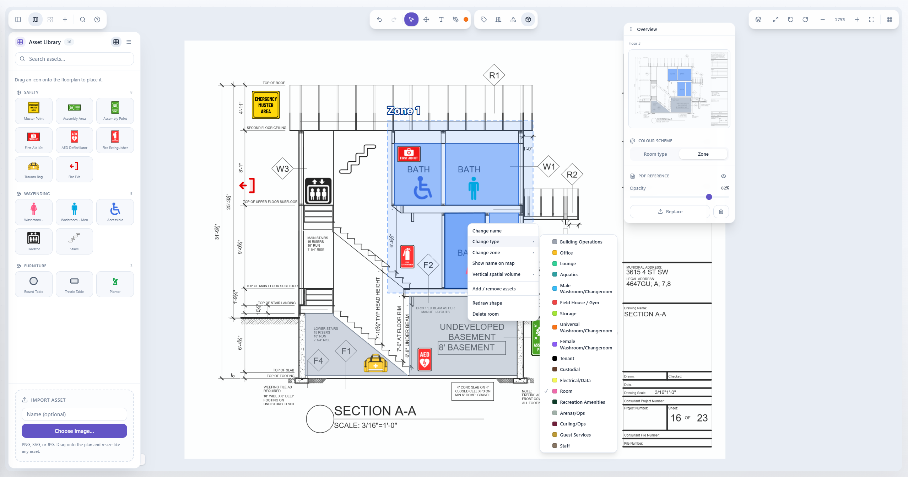
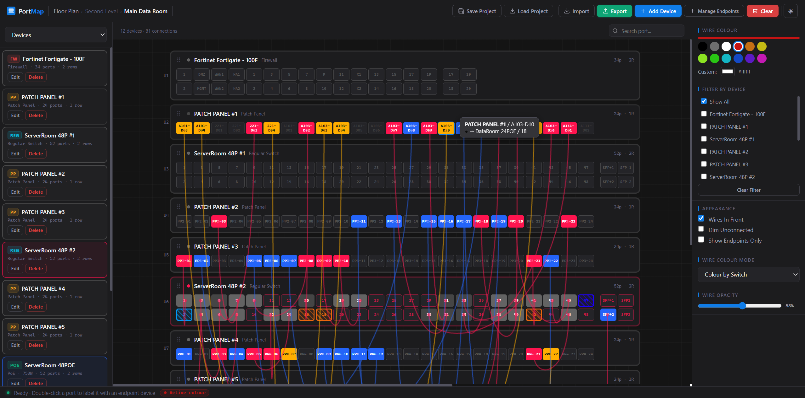
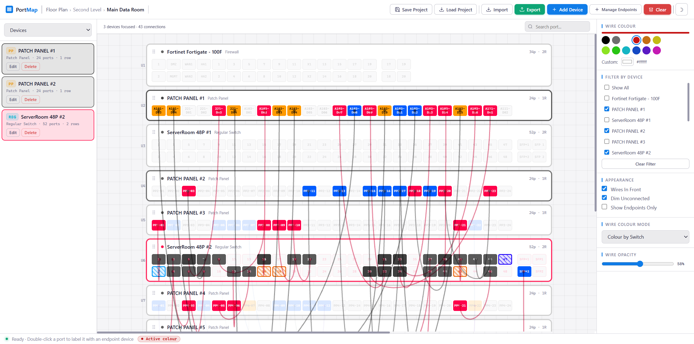

<!-- Banner: create a 1200x300 image and put it in assets/banner.png -->

# Hi, I'm Hannah 👋
### IT professional & builder of tools people actually enjoy using
Computer Science Graduate | Creative Problem Solver | Software Development | User-Focused Design

---

## About me

I spot repetitive problems at work and figure out the best way to build software that makes someone's job easier. I start from the end user's perspective, because the best tool is the one that solves what people actually need. I love the design side too: making interfaces clear, friendly, and good-looking.

## Strengths

🎨 **Creativity** – UI/interface design that's polished and intuitive

🤝 **User-friendliness** – I dig into what end users need most!

💬 **Communication** – personable, and I work closely with the people I build for

## Tech

## Featured projects

### 🗺️ BuildingMap: Interactive Building Map App
**The problem:** The Health & Safety team had to redraw floor plans by hand and add asset images via Canva, then track assets' life cycles (last inspection, expiry, etc) in another app.

**The solution:** My application brings those processes together in one self-contained workspace. Upload a PDF floor plan, section off rooms with the line tool, name them, add text, and place vector assets like fire extinguishers. Track when each asset was last serviced or inspected and when it's due next, then export and print. It works like Canva but runs on your own device, so confidential data stays in-house.

**The goal:** Replace repetitive manual work with an intuitive, centralized solution.

### 🔌 PortMap: Network Data Room Mapper
**The problem:** IT needed to know which switch port connects to which before a major network overhaul, and a spreadsheet wasn't going to cut it.

**The solution:** An interactive visual representation of physical network infrastructure - a browser-based, cached app that's a digital copy of your data room. Add switches to a rack (PoE, Aggregate, etc.), pick wire colours, and map port A to port B, with wires that dangle like the real thing. Multiple data rooms can be attached to a building map.

**The goal:** Make large-scale network changes easier to plan, understand, and execute.

 

---

## A little more about me

I'm interested in building practical technology that makes a meaningful difference in how people work. I enjoy the intersection of technical problem-solving, creative design, and human interaction.

I believe good software isn't just about what it can do - it's also about how easily people can use it.

---

💼 Based in Calgary · 📫 Reach me at: onehp7@gmail.com

